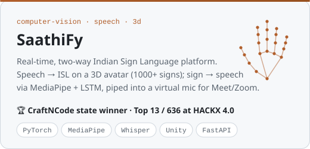
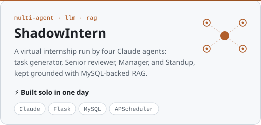
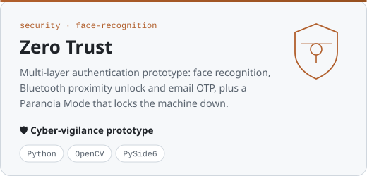
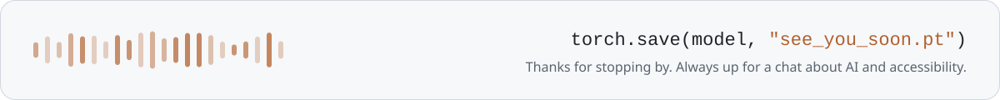

<!-- Profile README for github.com/HarshvardhanKh · assets are generated by build.py -->

<div align="center">

<a href="https://harshvardhan-khaitan.vercel.app/">
<picture>
  <source media="(prefers-color-scheme: dark)" srcset="assets/banner-dark.svg">
  
</picture>
</a>

<br>

<a href="https://github.com/HarshvardhanKh">
  
</a>

<br><br>

<a href="https://harshvardhan-khaitan.vercel.app/"></a>
<a href="https://www.linkedin.com/in/harshvardhankh/"></a>
<a href="mailto:harshvardhan.khaitan1202@gmail.com"></a>
<a href="https://www.noww.club/"></a>


</div>

<br>

## `>>> print(model.summary())`

```python
class Harshvardhan(nn.Module):
    def __init__(self):
        super().__init__()
        self.role       = "AI/ML Engineer @ Noww Club"              # remote, since Dec 2025
        self.education  = "B.Tech CSE @ Manipal University Jaipur"  # 2025 – 2029
        self.leads      = "Joint-Head of Technical Projects, IEEE CS MUJ"
        self.stack      = ["LLMs", "Agentic AI", "Computer Vision", "RAG", "ML Pipelines"]
        self.mission    = "AI that works for real people: accessibility first"

    def forward(self, idea):
        return ship(build_from_scratch(idea))   # one day, that includes my own OS
```

**Right now** I build the AI behind [Noww Club](https://www.noww.club/), an invite-only ritual club for intentional living. I shipped its personalization microservice: wellness profiles and daily ritual recommendations at onboarding, served through an async FastAPI API with per-IP rate limiting. I also build agentic workflows with Anthropic models on AWS Bedrock, train the models behind personalization, and own the data pipelines from preprocessing to deployment.

<br>

## 🧪 Featured work

<table>
  <tr>
    <td width="50%" valign="top">
      <a href="https://github.com/HarshvardhanKh/saathify-continued">
        <picture>
          <source media="(prefers-color-scheme: dark)" srcset="assets/card-saathify-dark.svg">
          
        </picture>
      </a>
      <sub>With <b>Disha Chopra</b> &amp; <b>Piyush Agarwal</b> · national final at IIIT Bhubaneswar, Feb 2027 · <a href="https://github.com/HarshvardhanKh/sathify">v1</a> · <a href="https://saathify-frontend.vercel.app">live</a></sub>
    </td>
    <td width="50%" valign="top">
      <a href="https://github.com/HarshvardhanKh/VarunaX">
        <picture>
          <source media="(prefers-color-scheme: dark)" srcset="assets/card-varunax-dark.svg">
          
        </picture>
      </a>
      <sub>Team lead &amp; ML lead · with <b>Disha Chopra</b> &amp; <b>Piyush Agarwal</b> · nominated for the national stage</sub>
    </td>
  </tr>
  <tr>
    <td width="50%" valign="top">
      <a href="https://github.com/HarshvardhanKh/InternShadow">
        <picture>
          <source media="(prefers-color-scheme: dark)" srcset="assets/card-shadowintern-dark.svg">
          
        </picture>
      </a>
      <sub>Resume → JSON at onboarding · scored reviews, weekly ranks, daily standups</sub>
    </td>
    <td width="50%" valign="top">
      <a href="https://github.com/HarshvardhanKh/zero-trust">
        <picture>
          <source media="(prefers-color-scheme: dark)" srcset="assets/card-zerotrust-dark.svg">
          
        </picture>
      </a>
      <sub>With <b>Amey Sharma</b> · logs every login attempt with IP and geolocation</sub>
    </td>
  </tr>
</table>

<details>
<summary><b>More experiments</b></summary>
<br>

| Project | What it does | Stack |
|---|---|---|
| **AttendX** · SIH 2025 semi-finalist | Face-recognition attendance for rural schools, plus a DeepFace emotion-based well-being score that flags distressed students early. I was AI/ML lead. | OpenCV, DeepFace, MySQL |
| [**AI Retail Sales Agent**](https://github.com/Coding-Storm-Official/Recode-and-Rewind) · top 10, Rewind & Recode 2025 | Omnichannel sales assistant with worker agents for recommendations, payments, fulfillment and support. | Python, PyTorch, MySQL |
| [**CV Goalkeeper**](https://github.com/HarshvardhanKh/cv-soccer-goalkeeper-game) | You are the goalkeeper: block shots with your body, tracked live by webcam pose estimation. | OpenCV, MediaPipe, Tkinter |

</details>

<br>

## 📈 Training curve

<picture>
  <source media="(prefers-color-scheme: dark)" srcset="assets/journey-dark.svg">
  
</picture>

<br>

## 🏁 Eval results

| Benchmark | Result | Model (project) |
|---|---|---|
| **CraftNCode** · IIIT Bhubaneswar | 🥇 **Winner, Rajasthan State Round** → national finalist | SaathiFy |
| **MUJ HACKX 4.0** · 36 h, 1,717 participants | 🏅 **Top 13 of 636 teams** | SaathiFy |
| **Smart India Hackathon 2026** · MUJ internal round | 🥇 **Winner** → nominated for the national stage | VarunaX |
| **Smart India Hackathon 2025** | 🎯 Semi-finalist | AttendX |
| **Rewind & Recode 2025** · IIIT Bhubaneswar | 🎯 Top 10 statewide | AI Retail Sales Agent |

<br>

## 🛠️ Stack

<table>
  <tr>
    <td align="right" width="150"><sub><b>Languages</b></sub></td>
    <td></td>
  </tr>
  <tr>
    <td align="right"><sub><b>AI / ML</b></sub></td>
    <td>
      
      
      
      
      
    </td>
  </tr>
  <tr>
    <td align="right"><sub><b>Backend &amp; data</b></sub></td>
    <td></td>
  </tr>
  <tr>
    <td align="right"><sub><b>Frontend &amp; 3D</b></sub></td>
    <td></td>
  </tr>
  <tr>
    <td align="right"><sub><b>Cloud &amp; tools</b></sub></td>
    <td></td>
  </tr>
</table>

<br>

## 📊 Activity

<div align="center">

<picture>
  <source media="(prefers-color-scheme: dark)" srcset="https://streak-stats.demolab.com?user=HarshvardhanKh&theme=github-dark-blue&hide_border=true&background=161B22&ring=CF8047&fire=E8A36B&currStreakLabel=E8A36B&sideLabels=E6EDF3&dates=8B949E&currStreakNum=E6EDF3&sideNums=E6EDF3">
  
</picture>

<!-- Contribution snake: uncomment once the snake workflow has run once (it publishes to the `output` branch)
<br><br>

<picture>
  <source media="(prefers-color-scheme: dark)" srcset="https://raw.githubusercontent.com/HarshvardhanKh/HarshvardhanKh/output/snake-dark.svg">
  
</picture>
-->

</div>

<br>

## 🧭 Off the keyboard

🎙️ National debate podium and MUN Special Mention &nbsp;·&nbsp; 🏐 District volleyball winner &nbsp;·&nbsp; 🎸 Guitar &nbsp;·&nbsp; 🧑‍🏫 Ran an AI workshop for ~50 NGO students &nbsp;·&nbsp; 🐍 Lead organizer of VENOM 2.0

<br>

<picture>
  <source media="(prefers-color-scheme: dark)" srcset="assets/footer-dark.svg">
  
</picture>
